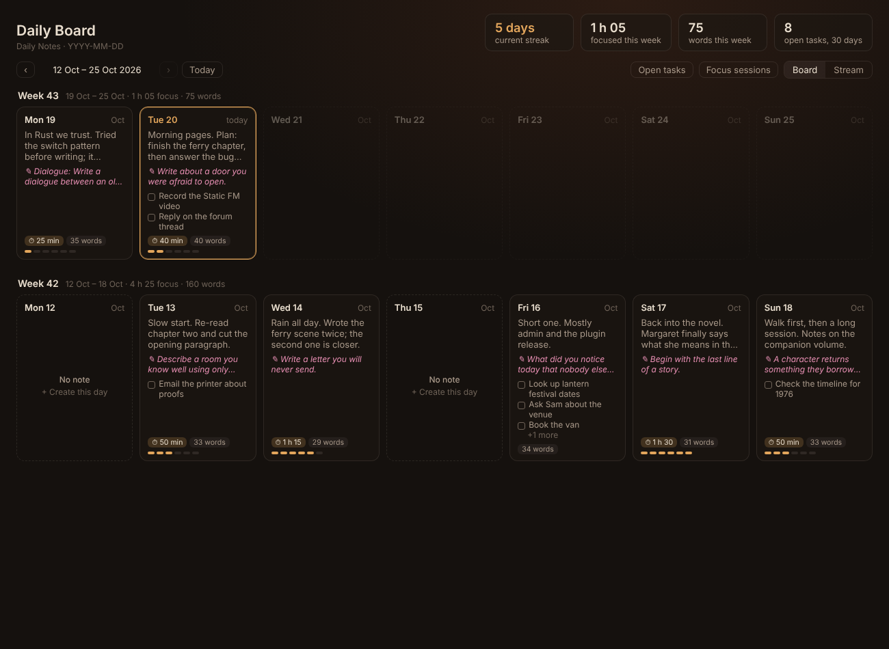
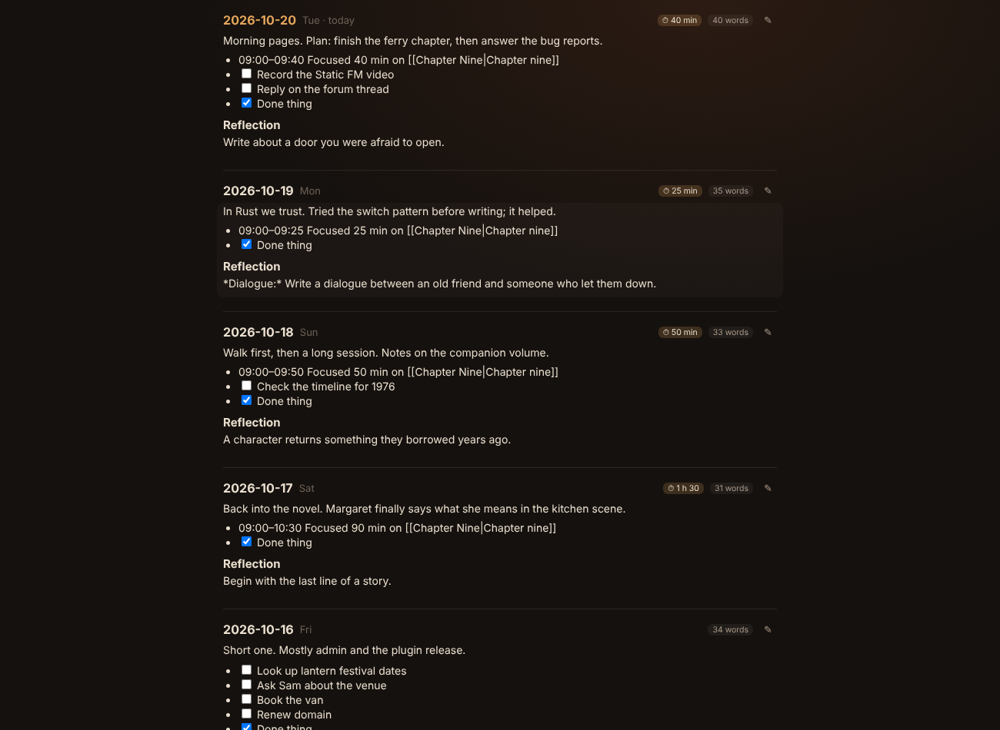
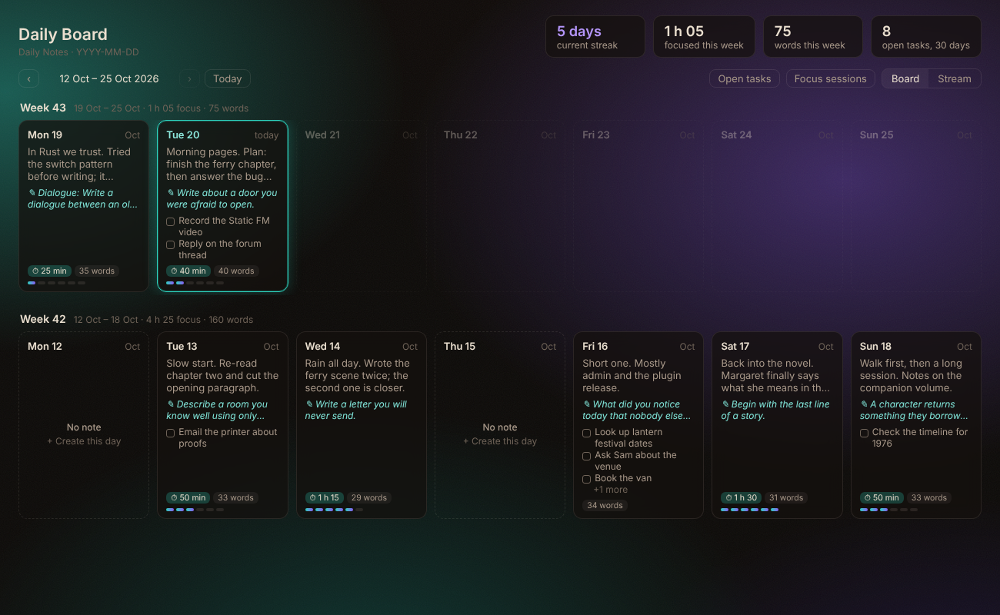

# Daily Board

Your daily notes as a board. Each week is a row of cards, Monday to Sunday, so you can see at a glance what you wrote, what you focused on and what's still open. Switch to **Stream** to read and edit the days one after another, Logseq-style.

## What it shows

- **A card for every day** with the first lines you wrote, the writing prompt (from a heading such as `## Reflection`, which One Page uses), your open tasks, focus time and word count, plus a small heat bar.
- **Missed days** are dashed cards. Click one to create that day's note from your daily notes template. Future days are faded.
- **Totals**: current streak, time focused this week, words this week and open tasks from the last 30 days.
- **Filters**: show only days with open tasks, or only days with focus sessions.
- **Focus time** adds up lines like `Focused 25 min`, which Lantern Focus writes, so it works with any timer that logs the same way.

Click a card to jump to that day in the stream. Ctrl/Cmd-click opens the note itself.

## Stream

The stream shows your recent days in full, newest first. Tick tasks right there. Click the pencil (or double-click the text) to edit a day in place; it saves as you type. Press Esc or Ctrl+Enter to finish. Missed days show a **Create** button, and **Show earlier days** loads more.

## Settings

- **Daily notes**: uses the core Daily Notes plugin's folder, date format and template by default. Turn that off to set your own.
- **Include subfolders**: finds daily notes in folders inside your daily notes folder too, such as an `Archive` folder, by file name. On by default. New days are still created in the main folder.
- **Prompt heading**: the heading whose first line is shown as the day's prompt (default `Reflection`).
- **Layout**: week starts on Monday or Sunday, how many weeks the board shows, how many days the stream shows.
- **Background**: None (your theme shows through), two built-in aurora pictures, any picture from your vault (with Darken and Blur), or **Static Aurora (live colours)**.

### Static Aurora (live colours)

Made for the [Static Aurora](https://github.com/AshOtis/aurora-theme) theme. The board shows the theme's drifting aurora glows, and today's card, the focus pills, prompts and heat bars take on the same colours. When Static FM, Aurora MP3 or Hi-Fi Tuner recolour the theme, the board changes with it. Glow and Darken sliders set how strong it is. With another theme it uses Static Aurora's default colours.

- **Open when Obsidian starts**: makes the board your home page.

The board uses your theme's colours, so it fits any theme.

## Privacy and network

Daily Board makes no network requests. It only reads your daily notes, and only writes to them when you tick a task, edit a day or create a missing day.

## Support

If you like it, you can [buy me a coffee](https://buymeacoffee.com/ashotis). Bugs and ideas: [issues](https://github.com/AshOtis/Daily-Board/issues).

[GNU AGPL v3 or later](LICENSE) © AshOtis.
